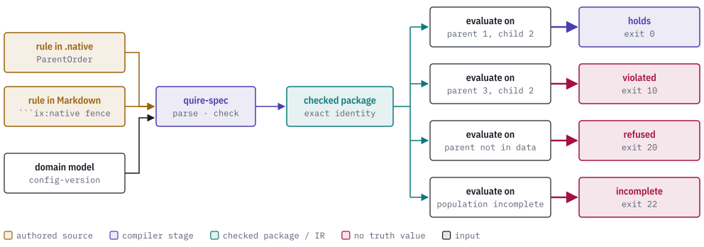
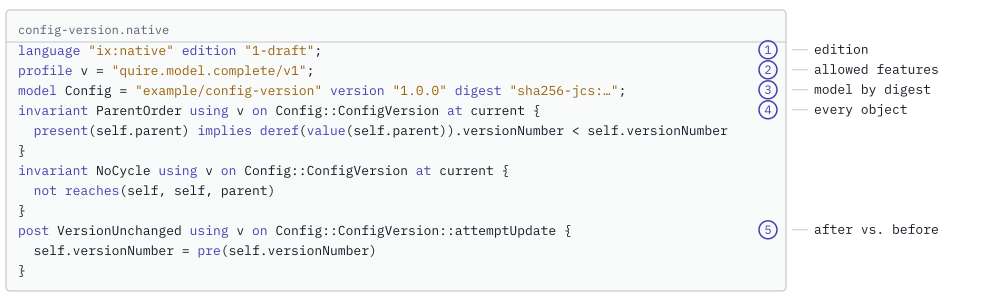
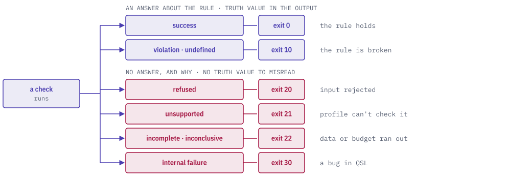
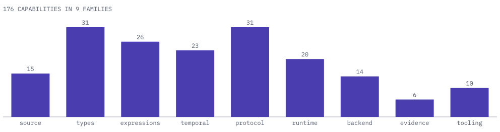
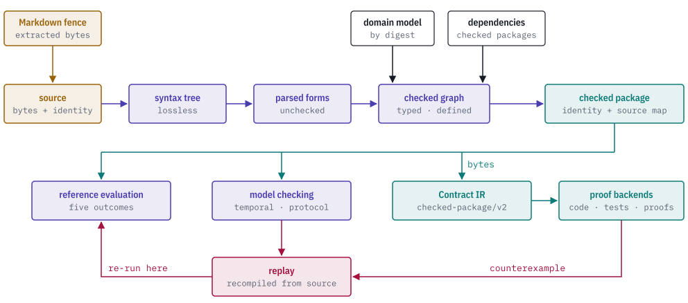
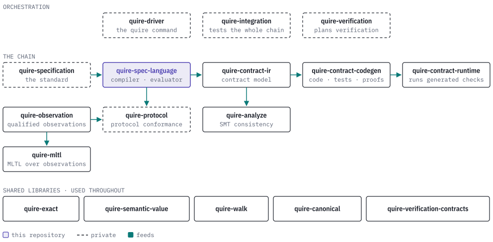
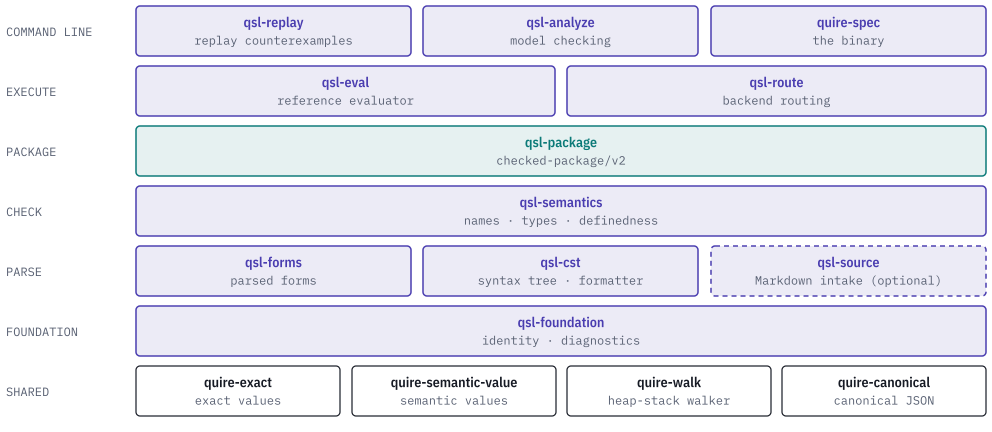

# Quire Specification Language

[](https://discord.gg/k8DVhuYBR2)

A specification is a set of rules about a system: *a config version's parent
always has a lower version number*, *a refund is issued within five steps of a
failed charge*, *the payments service only answers requests the orders service
sent*. Most specifications state those rules in prose, and prose cannot be run.

The Quire Specification Language (QSL) is a small formal language for writing
those rules so a machine can check them, and this repository is its compiler and
reference evaluator. You write a rule once, next to the prose it formalizes. QSL
checks that the rule is well formed against your domain model, packages it with
an exact identity, and then either evaluates it against real data or hands it to
proof and code-generation backends.

QSL has one rule of its own that shapes everything else: **it never answers
"false" when the honest answer is "I couldn't tell."** Stale data, a missing
observation, an unsupported construct or a spent budget each get their own
outcome, so a reported violation always means the rule was really broken.

<picture>
  <source media="(prefers-color-scheme: dark)" srcset="docs/images/hero-dark.svg">
  
</picture>

> **Status: public prerelease.** The language, its editions and every API here
> are still changing. No crate is published yet. Expect breaking changes.

## A first rule

Here is a complete QSL unit. It states three rules about a `ConfigVersion`
object from a domain model called `example/config-version`:

<picture>
  <source media="(prefers-color-scheme: dark)" srcset="docs/images/first-rule-dark.svg">
  
</picture>

```
language "ix:native" edition "1-draft";
profile v = "quire.value.complete/v1";
model Config = "example/config-version" version "1.0.0" digest "sha256-jcs:…";

invariant ParentOrder using v on Config::ConfigVersion at current {
  present(self.parent) implies deref(value(self.parent)).versionNumber < self.versionNumber
}

invariant NoCycle using v on Config::ConfigVersion at current {
  not reaches(self, self, parent)
}

post VersionUnchanged using v on Config::ConfigVersion::attemptUpdate {
  self.versionNumber = pre(self.versionNumber)
}
```

Read it top to bottom:

- **`language … edition`** says which version of the language the file uses, so
  old files keep their meaning when the language grows.
- **`profile`** selects the part of the language the rules are allowed to use.
  `quire.value.complete/v1` is values, records and expressions. The line binds
  it to the short name `v`, and each rule says `using v`.
- **`model`** imports the domain model the rules talk about. It names the model
  by identity, version *and* content digest, so a rule can never silently be
  checked against a different model than the one it was written for.
- **`invariant … at current`** must hold for every `ConfigVersion` in the data.
  `ParentOrder` says a parent, when there is one, has a lower number:
  `self.parent` is an optional reference, `present` asks whether it is set,
  `value` takes the reference out and `deref` follows it to the parent object.
  `NoCycle` says following `parent` links never leads back to where you started.
- **`post … on …::attemptUpdate`** is checked around an operation. `pre(x)` is
  the value of `x` before the operation ran, so `VersionUnchanged` says an update
  attempt must not change the version number.

### Rules live in your spec

You don't have to keep rules in separate files. Quire spec artifacts are
Markdown documents, and a rule can sit in a fenced block right under the prose
it formalizes:

````markdown
### ParentOrder

A version's parent, when it has one, always has a lower version number.

```ix:native
invariant ParentOrder using v on Config::ConfigVersion at current {
  present(self.parent) implies deref(value(self.parent)).versionNumber < self.versionNumber
}
```
````

With the optional `quire-extraction` feature, QSL takes the block's exact bytes
from the Markdown file (the extraction is done by
[quire-rs](https://github.com/agent-ix/quire-rs)) and keeps a map back to the
original document. An error in the rule is reported at its line and column in
the Markdown file, not in some temporary copy. This is a library API today;
the `run` command does not yet take Markdown for `1-draft` rules.

## Five answers, not two

A checker that only says *true* or *false* has to pick one when it can't
actually decide, and either pick is a lie. QSL keeps every way a check can end
apart, all the way out to the process exit code:

<picture>
  <source media="(prefers-color-scheme: dark)" srcset="docs/images/outcomes-dark.svg">
  
</picture>

| Outcome | Exit | What it means |
| --- | --- | --- |
| success | 0 | The check completed and the rule holds. |
| violation, undefined | 10 | The check completed and the rule is broken, or the rule asked for something with no defined value. |
| refused | 20 | The input was rejected before any rule ran: bad syntax, a wrong model digest, a malformed request. |
| unsupported | 21 | The construct is valid QSL, but the selected profile or backend cannot check it. |
| incomplete, inconclusive | 22 | Data was missing or the work budget ran out. No truth value is reported at all. |
| internal failure | 30 | A bug in QSL itself. |

Internal failure is not one of the five answers: it means QSL is broken, not
that the rule or the data is. Two consequences follow. A refused or incomplete result carries no truth field
in its output, so a script cannot accidentally read one as *false*. And every
result names the exact source, model and input it was computed from, so you can
always say which rule, at which revision, produced it.

## What you can say

Every QSL unit chooses its profiles, and each profile opens up one family of
rules. The families below are all in the `1-draft` edition. The snippets are
excerpts: names such as `G`, `T` and `P` are profiles, and `M` is a model,
each declared at the top of the unit as in the first example.

**Values and functions.** Bounded integers, exact rationals, records, unions
and pure functions. There is no floating point, so arithmetic is exact.

```
type Digit = Int[0, 9];
record Point { x: Digit; y: Digit; }
function px using v(p: Point): Digit pure { if p.x > p.y then p.x else p.y }
```

**State.** Invariants over the current objects, and `pre`/`post` rules around
operations, including sums and sizes over collections.

```
invariant Healthy using G on M::Workflow at current {
    size<M::Tally>(self.receipts) <= 5
    and sum<M::Total>(receipt in self.receipts: receipt) <= self.total
}
```

**Time.** Temporal rules over a sequence of events, with explicit clocks and
bounded windows: "from the origin, for the next 30 events, the ratio stays
allowed".

```
temporal Due using T over (view: M::Workflow) clock "events" on origin {
    always[0,30] holds(Allowed(view.ratio))
}
```

**Protocols.** Choreographies between services: roles, channels with ordering
and delivery bounds, sequences, choices, parallel branches, retries, timeouts
and compensation when something fails. An excerpt:

```
protocol Orders using P over (view: M::WorkflowView) on each (started: M::StartView) when (started.ready) {
  role OrdersService on M::OrderService;
  role PaymentsService on M::PaymentService;
  channel Requests from OrdersService to PaymentsService carries M::ChargeRequest
    ordering fifo by (message: M::ChargeRequest) { message.key } delivery [0,3];
  run sequence Main {
    send Sent via Requests as (sent: M::SendView) { sent.amount = requested };
    receive Received via Requests of Sent as (received: M::ReceiptView) { received.ok };
    commit Committed by OrdersService as (committed: M::CommitView) { committed.ok };
  }
}
```

The full version, with compensation, retries and timeouts, is
[`tests/fixtures/composed-choreography.native`](tests/fixtures/composed-choreography.native).

| Profile | Family |
| --- | --- |
| `quire.value.complete/v1` | values, records, functions, predicates |
| `quire.state.graph/v1` | invariants, `pre`/`post`, reachability over object graphs |
| `quire.temporal.event-position.false-extension/v1` | temporal rules over event positions |
| `quire.temporal.timestamped-event.finite-window/v1` | temporal rules over timestamped events in a finite window |
| `quire.temporal.fixed-sample.false-extension/v1` | temporal rules over fixed-rate samples |
| `quire.temporal.infinite-trace/v1` | temporal rules over unbounded traces (model checking) |
| `quire.protocol.finite-global/v1` | protocols between roles |

The complete `1-draft` language is defined as a closed list of capabilities,
grouped into nine families. QSL checks a package against that whole list, so
"supported" is never a matter of opinion:

<picture>
  <source media="(prefers-color-scheme: dark)" srcset="docs/images/capabilities-dark.svg">
  
</picture>

**Editions.** Everything here is the `1-draft` edition, the complete version-1
language. An older `0-draft` edition is still in the tree for historical
fixtures and is being deleted; don't write new rules in it.

## How it works

QSL is a staged compiler. Each stage takes the previous stage's output type and
produces a new one, and no stage can be skipped. The type system enforces this:
an unchecked rule and a checked rule are different Rust types, so unchecked
input can't reach an evaluator or backend by accident.

<picture>
  <source media="(prefers-color-scheme: dark)" srcset="docs/images/pipeline-dark.svg">
  
</picture>

| Stage | What it guarantees |
| --- | --- |
| **Source** | Exact bytes with an identity: authority, id and revision. Markdown fences enter here too. |
| **Syntax tree** | A byte-exact tree of the source, comments and spacing included. The formatter works from it. Parsing alone means nothing about correctness. |
| **Parsed forms** | One unchecked form per declaration, each with its source span. |
| **Checked graph** | Every name is resolved against the imported domain model and dependency packages, every expression is typed, and every partial operation (a division, a dereference) is proved defined or turned into an explicit runtime obligation. |
| **Checked package** | The checked rules plus their dependencies' checked rules, with a package identity and a source map. It can be written out as `quire.checked-package/v2` bytes for other tools. |
| **Reference evaluation** | Deterministic, side-effect-free execution against supplied data, ending in one of the five outcomes above. |
| **Model checking** | In-process engines for temporal and protocol rules: model checking, timed-zone search, schedulability and probabilistic analysis. |
| **Proof backends** | [Contract IR](https://github.com/agent-ix/quire-contract-ir) reads the v2 bytes, and [contract codegen](https://github.com/agent-ix/quire-contract-codegen) generates code, property tests and bounded proofs from it. |
| **Replay** | A counterexample from any engine is recompiled from its original source and re-run on the reference evaluator. A backend's "violated" only stands if QSL's own evaluator agrees. |

## Try it

You need Rust; [`rust-toolchain.toml`](rust-toolchain.toml) pins the exact
toolchain, so `rustup` picks it up automatically. Nothing else: no Node, no JVM,
no network service.

```sh
git clone https://github.com/agent-ix/quire-spec-language
cd quire-spec-language
cargo build --locked --bin quire-spec
```

**Format.** `format` prints the canonically formatted source and leaves the
file unchanged. The four labels before the path are the source's identity
(authority, id, revision namespace, revision); every diagnostic carries them.

```sh
target/debug/quire-spec format agent-ix test:spine fixture fixture:1 tests/fixtures/spine-compile.native
```

**Run a rule against data.** The ConfigVersion example writes one directory
per case: the `1-draft` unit from [A first rule](#a-first-rule), its domain
model and a snapshot of `ConfigVersion` objects. A small script then writes a
`run.json` request that selects one rule, checked for the object keyed `child`:

```sh
cargo run --locked --example config_version_fixtures -- /tmp/config-version
for case in healthy-parent violating-parent dangling-parent incomplete-population; do
  examples/config-version/requests.sh /tmp/config-version/$case ParentOrder
  target/debug/quire-spec run /tmp/config-version/$case/run.json; echo "exit $?"
done
```

| Case | Data | Outcome | Exit |
| --- | --- | --- | --- |
| `healthy-parent` | parent version 1, child version 2 | the rule holds | 0 |
| `violating-parent` | parent version 3, child version 2 | the rule is broken | 10 |
| `dangling-parent` | the parent is not in the snapshot | refused | 20 |
| `incomplete-population` | the snapshot's population is not complete | incomplete | 22 |

`requests.sh /tmp/config-version/cycle NoCycle` checks the other invariant,
which the `cycle` case breaks (exit 10). Each result is one JSON document on
stdout that names the source, model and snapshot it was computed from.

**Compile a package.** The same script writes `compile.json`. `compile` prints
the checked package as `quire.checked-package/v2` JSON, for other tools to read:

```sh
target/debug/quire-spec compile /tmp/config-version/healthy-parent/compile.json > package.json
```

The [ConfigVersion example](examples/config-version/README.md) lists all
seventeen cases, covering parents, cycles, object identity, operation frames,
and refused and incomplete runs. `run` also evaluates a single pure function
from a unit; [`tests/it/spine_run.rs`](tests/it/spine_run.rs) shows that
request.

**Optional features.**

| Feature | Adds |
| --- | --- |
| `quire-extraction` | Rules read straight out of Quire Markdown spec artifacts, with locations mapped back to the document. |
| `handoff-writer` | The producer for the compiled-protocol handoff files that protocol tools consume. |
| `population-fixtures` | The writer for the population fixtures used by the admission tests. |

`quire-spec` is the compiler's own command line. The everyday front door will be
`quire` from quire-driver (private), which runs QSL, Contract IR and the
backends as one tool.

## The Quire ecosystem

QSL is one part of a family of repositories. Small shared libraries sit at the
bottom; the standard defines what the language means; QSL compiles it; the
contract tools turn checked packages into code, proofs and runtime checks.

<picture>
  <source media="(prefers-color-scheme: dark)" srcset="docs/images/ecosystem-dark.svg">
  
</picture>

| Repository | Role | Relation to QSL |
| --- | --- | --- |
| quire-specification (private) | The language standard: what each rule means, the profiles, the interchange formats and the conformance tests every implementation must pass. | QSL implements it; `make ci` checks QSL against the standard's test vectors. |
| [quire-exact](https://github.com/agent-ix/quire-exact) | Exact numbers and closed outcomes, with no floating point; `no_std`. | QSL depends on it. |
| [quire-semantic-value](https://github.com/agent-ix/quire-semantic-value) | Semantic values with their origin, on top of quire-exact; `no_std`. | QSL depends on it. |
| [quire-walk](https://github.com/agent-ix/quire-walk) | Walks deep trees on a heap stack instead of the call stack; `no_std`. | QSL depends on it. |
| [quire-canonical](https://github.com/agent-ix/quire-canonical) | Canonical JSON (RFC 8785) that hashes as it writes, so equal content gets equal identity. | QSL depends on it. |
| [quire-contract-ir](https://github.com/agent-ix/quire-contract-ir) | The target-neutral contract model that backends work from. | QSL depends on its model crate; IR reads QSL's checked packages. |
| [quire-contract-codegen](https://github.com/agent-ix/quire-contract-codegen) | Generates Rust, property tests, bounded proofs and evidence from contracts. | Depends on QSL to replay counterexamples. |
| [quire-contract-runtime](https://github.com/agent-ix/quire-contract-runtime) | The small `no_std` runtime that generated checks run on. | Used by codegen's output. |
| [quire-analyze](https://github.com/agent-ix/quire-analyze) | SMT-based consistency and implication checks across contracts. | Works on Contract IR. |
| [quire-verification-contracts](https://github.com/agent-ix/quire-verification-contracts) | The shared vocabulary of verification records the tools exchange. | Used by IR, codegen and the standard. |
| [quire-observation](https://github.com/agent-ix/quire-observation) | Turns raw signals into qualified observations that rules can be evaluated over. | Supplies data for temporal checks. |
| [quire-mltl](https://github.com/agent-ix/quire-mltl) | Connects the MLTL temporal-logic engine to quire-observation. | No direct dependency. |
| quire-protocol (private) | Checks real systems against compiled protocols, including compensation. | Consumes QSL's compiled protocols. |
| quire-verification (private) | Chooses verification techniques and plans for each requirement. | No direct dependency. |
| quire-driver (private) | The `quire` command line that runs the whole chain. | Depends on QSL. |
| quire-integration (private) | Pins a working set of versions and tests the whole chain together. | Depends on QSL. |

## Inside this repository

The compiler is a Cargo workspace. Its crates form strict layers: a crate may
only depend on the layers below it, and a lint (`make arch-lint`) enforces that.

<picture>
  <source media="(prefers-color-scheme: dark)" srcset="docs/images/layers-dark.svg">
  
</picture>

| Crate | Does |
| --- | --- |
| `qsl-foundation` | Source identity, source maps, diagnostics and exit codes, wire-format names. |
| `qsl-cst` | Lexer, grammar, the lossless syntax tree and the formatter. |
| `qsl-forms` | Parsed, unchecked forms for each declaration family. |
| `qsl-semantics` | Model intake, name resolution, type checking and definedness proofs. The largest crate. |
| `qsl-package` | Checked packages and the `quire.checked-package/v2` writer and reader. |
| `qsl-eval` | The reference evaluator, including temporal automata and finite simulation. |
| `qsl-route` | Matches what a package needs to the backends that can check it. |
| `qsl-analyze` | In-process model checking, timed zones and schedulability. |
| `qsl-replay` | Recompiles and re-runs counterexamples; the entry point codegen calls. |
| `qsl-source` | Reads rules out of Quire Markdown (feature `quire-extraction`). |
| `qsl-attrs`, `qsl-walk-grow`, `qsl-bench` | A lint marker attribute, deep-recursion stack growth, benchmarks. |
| root crate | The `quire-spec` binary and the library facade. |
| `xtask`, `tools/arch-lint` | Repository checks: dependency direction, API surface, conformance. |

The rest of the tree:

- [`spec/`](spec/) holds the requirements. Each requirement, acceptance
  criterion and test case is its own Markdown file, and tests are tagged with the
  criteria they check.
- [`spec/decisions/`](spec/decisions/) holds the architecture decisions,
  including the stage design above.
- [`docs/`](docs/) holds reference pages: the
  [library notes](docs/library-notes.md), the
  [diagnostic codes](docs/native-error-codes.md), the
  [run request format](docs/native-standalone.md), the
  [compiled protocol wire format](docs/compiled-protocol-v2.md) and others.

## Contributing

`make ci` is the full local gate: formatting, clippy, tests with every feature
combination, docs and the architecture lints. It reads the standard's test
vectors from a sibling `quire-specification` checkout (`QSPEC_DIR`).
Hosted CI runs only when dispatched by hand, so run the gate locally before
opening a pull request. See [CONTRIBUTING.md](CONTRIBUTING.md) and
[AGENTS.md](AGENTS.md).

Contributions need the [CLA](CLA.md). QSL is licensed under
[AGPL-3.0-or-later](LICENSE); fixtures keep the `AGPL-3.0-only` header they were
written with. See [LICENSE-DECISION.md](LICENSE-DECISION.md).
