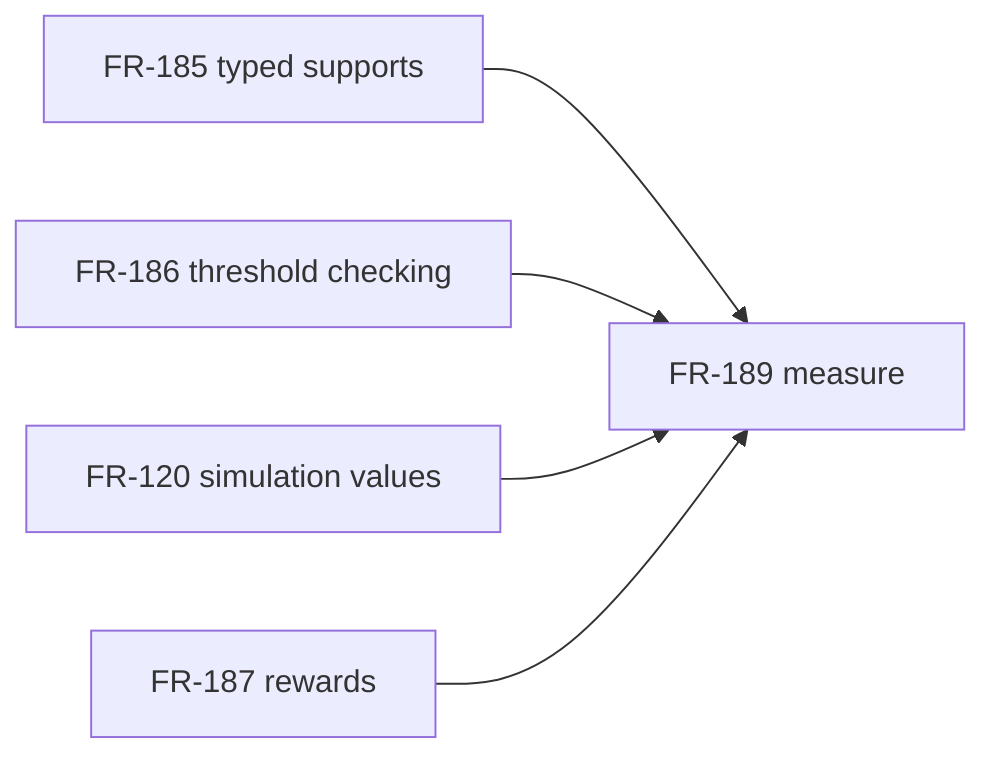

## Summary

The dependency chain is acyclic. FR-185 supplies typed random parameter domains, FR-186 checks and normalizes quantity thresholds, FR-120 owns exact simulation value encoding, and FR-189 consumes the checked reward type and reports the quantile.

## Findings

| ID | Severity | Summary | Refs |
| --- | --- | --- | --- |
| FND-001 | low | No missing or cyclic dependency was found for the implemented path. | FR-120; FR-185; FR-186; FR-189 |

## Dependency graph

FR-185 and FR-186 provide the type and threshold contracts; this change implements the FR-120 and FR-189 consumer path.
