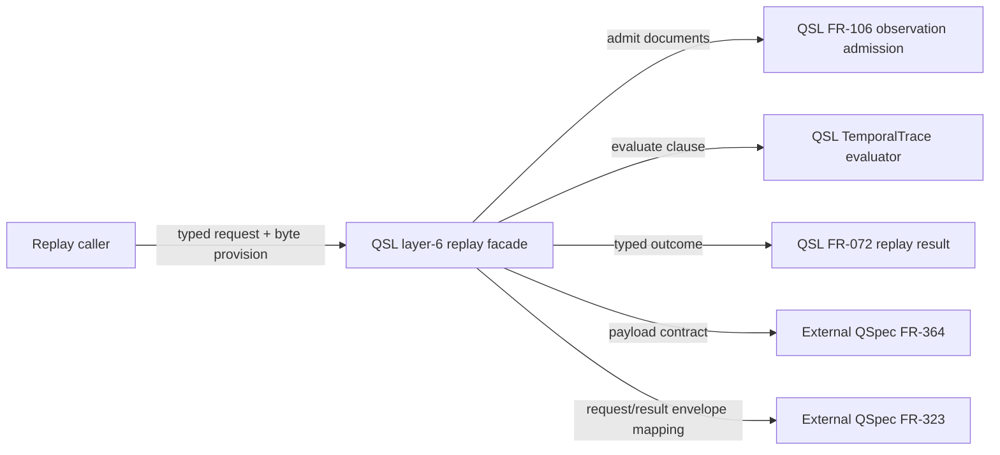

## Summary

QSL’s layer-6 replay facade owns typed request decoding, observed document admission, temporal replay and settlement. QSpec FR-364 defines the observed counterexample payload, while FR-323 carries replay inputs, result dispositions and counterexamples in separate envelope members; QSL’s adapter mapping between these shapes needs to be explicit.

## Findings

| ID | Severity | Summary | Refs |
| --- | --- | --- | --- |
| FND-001 | high | QSL FR-071 requires a typed observed-counterexample arm to survive request encode/decode, FR-098 dispatches it through `qsl_replay::replay`, and FR-072 requires a typed observed-temporal result. QSpec FR-323 separates `replay` inputs, `results` dispositions and `counterexamples`; its replay property itself has no observed payload, while FR-364 defines the payload in a counterexample entry. The requirements do not state whether QSL's new request/result wire round trip is an in-process adapter joining those existing members or a change to the external FR-323 envelope. Define that mapping and the identity join; if a new external member is required, obtain the QSpec contract change before claiming FR-323 compatibility. | FR-071, FR-072, FR-098, FR-331, QSpec FR-323, QSpec FR-364 |

## System Context

## In-Scope Responsibilities

- FR-071: define/decode the request and shared typed counterexample variants, preserving the model payload and validating observed digests.
- FR-098: dispatch the state-clause observed arm to FR-331 through the public `qsl_replay::replay` facade.
- FR-072: define the typed observed-temporal result and safe settlement constructor.
- FR-331: recompile and resolve the clause and packet identity, admit documents, enforce profile/fairness/interval rules, evaluate and compare the outcome with the packet.
- TC-847: verify request encode/decode, position distinction, undefined replay and fairness refusal.

## External Dependencies

| Dependency | Type | Assumed or Guaranteed | Contract |
| --- | --- | --- | --- |
| QSpec FR-364 | Typed counterexample wire payload | Assumed at the specification boundary; QSL verifies the observed form during request decoding | FR-364 observed-arm wire-form table; TC-847 payload assertions |
| QSpec FR-323 | NativeRuntimeEnvelope request/result wire | Assumed; QSL adapter mapping is not yet specified | FR-323 `replay`, `results` and `counterexamples` members; specify identity join and mapping, and amend FR-323 only if a new external member is needed |

## Responsibility Allocation

| Requirement | Owning Component | Class |
| --- | --- | --- |
| FR-071 | `qsl-replay` typed request decoder | infrastructure |
| FR-098 | `qsl-replay::replay` dispatcher | core |
| FR-072 | `qsl-replay` typed result carrier | core |
| FR-331 | `qsl-replay::replay` observed temporal path | core |
| TC-847 | `qsl-replay` integration tests | cross-cutting |

## Round 2 Disposition

| FND | Outcome | Evidence / remaining issue |
| --- | --- | --- |
| FND-001 | fixed | The external boundary now resolves against QSpec FR-323/FR-364: FR-071 maps the request to `state_clause`, `ReplaySource: Witness`, the observed `TemporalCounterexample` payload and `WitnessEnvelope` clause/claim identity; FR-072 maps its result to FR-323's exact closed `observed_temporal` members and value variants. The envelope/payload trace-position equality is checked before document admission. No remaining scope allocation gap found. |

## Final Disposition — Second Fix Round

The stated QSpec boundary remains exact. FR-071 now assigns separate source, payload, digest, target, and position refusal locations; FR-331 owns parity and fairness behavior; FR-072 owns the typed result mapping. No remaining scope-boundary blocker found.
