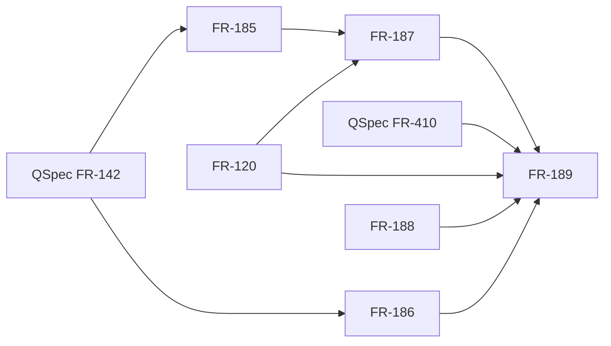

## Summary

The prerequisite graph is acyclic. FR-185 and FR-186 establish typed supports and normalized thresholds; FR-120 and FR-187 supply simulation values and rewards; FR-189 consumes those contracts.

## Findings

| ID | Severity | Summary | Refs |
| --- | --- | --- | --- |
| FND-001 | low | No missing or cyclic prerequisite found in the changed path. | FR-120; FR-185; FR-186; FR-187; FR-189 |

## Classification

| Requirement | Class | Rationale |
| --- | --- | --- |
| FR-120 | Feature | Simulates model states and emits typed state/transition values. |
| FR-185 | Feature | Admits random parameter distributions, including quantity supports. |
| FR-186 | Feature | Checks probabilistic claims and normalizes same-dimension thresholds. |
| FR-187 | Feature | Supplies weighted steps and typed reward values. |
| FR-188 | Feature | Draws weighted choices for each sampled behavior. |
| FR-189 | Feature | Reports statistical decisions and quantiles over sampled measures. |
| QSpec FR-142 | Feature | External contract for quantity values, units and explicit conversion. |
| QSpec FR-410 | Feature | External contract for statistical results and their unit context. |

## Dependency graph

## Suggested order

1. QSpec FR-142; FR-120, FR-185 and FR-186.
2. FR-187 and FR-188.
3. QSpec FR-410 and FR-189.

Cycles: none.
