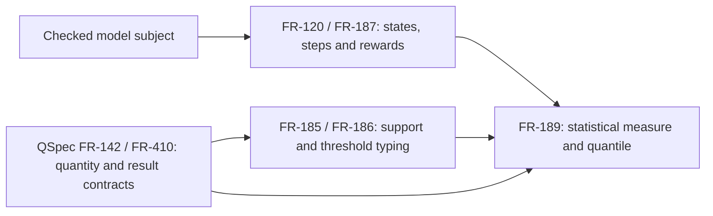

## Summary

The requirement boundary is clear: QSL EN-4 carries the exact measured magnitude in checked claim context; upstream QSL requirements establish unit typing and simulation inputs, while QSpec owns the external unit and statistical-result contracts.

## Findings

| ID | Severity | Summary | Refs |
| --- | --- | --- | --- |
| FND-001 | low | No unallocated responsibility or unstated external service dependency found. | FR-120; FR-185; FR-186; FR-187; FR-189 |

## System context

## Responsibility allocation

| Requirement | Owner | Class |
| --- | --- | --- |
| FR-120 | QSL model simulation | Core |
| FR-185, FR-186 | QSL S3 claim and support checking | Core |
| FR-187 | QSL probabilistic model simulation | Core |
| FR-189 | QSL EN-4 statistical analysis | Core |

## External contracts

| Dependency | Type | Assumed or guaranteed | Contract |
| --- | --- | --- | --- |
| QSpec FR-142 | Quantity and unit semantics | Guaranteed by the named spec and FR-186 checks | Explicit quantity conversion and unit compatibility |
| QSpec FR-410 | Statistical result contract | Guaranteed by the named spec and FR-189 result semantics | Quantity estimates use the checked threshold unit |
